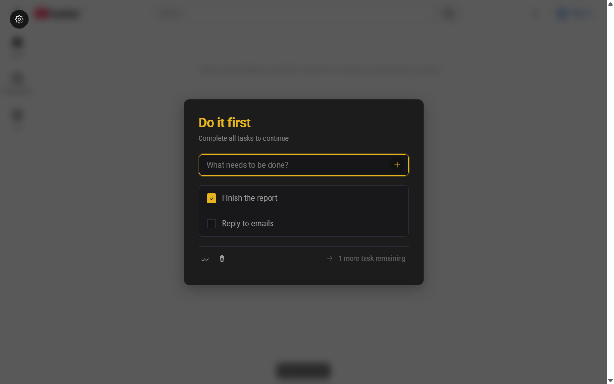

  

<h1 align="center">doitfirst</h1>

Finish your tasks before social media gets your time.

  

## Features

- **Task gate**: covers X, YouTube, Instagram and TikTok until your tasks are done
- **Session timer**: 25 minutes by default, then the site locks again
- **No free refills**: the time left survives reloads and new tabs, and each new session needs a new task
- **Background playback counts**: a hidden tab only pauses the timer if nothing is playing
- **Media pausing**: videos stop and fullscreen closes while the task list is open
- **YouTube focus tools**: hide Shorts, the home feed and recommended videos
- **Synced**: tasks and settings follow your Chrome account

## Install

1. Clone this repository
2. Open `chrome://extensions` and turn on **Developer mode**
3. Click **Load unpacked** and select the repository folder

## License

MIT
